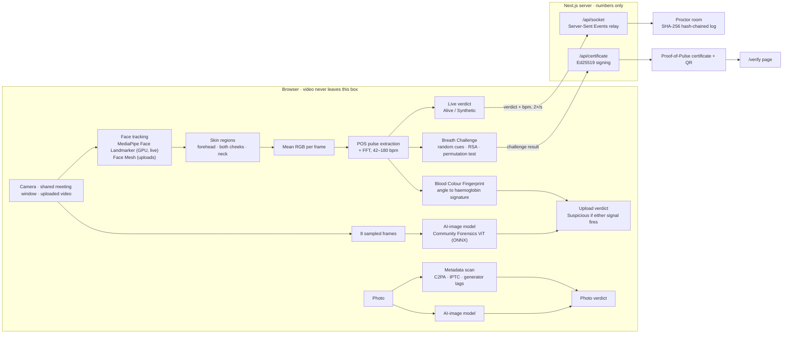

# DeepPulse-Zero

**Is there blood behind the face?** A browser app that checks whether a face on camera belongs to a living person, by reading the tiny colour changes each heartbeat makes in the skin (remote photoplethysmography). Video never leaves the browser.

## Architecture

Everything that touches video runs in the browser. The server only relays numbers (verdicts, heart rates) and signs certificates.



## Run it

Needs Node.js 22.18+ (for the tests) and desktop Chrome or Edge.

```bash
npm install
npm run dev
```

Open http://localhost:3000 (scanner) and http://localhost:3000/proctor (proctor room) in a second tab.

To let phones on the same Wi-Fi reach it (for scanning certificate QR codes), start it with `npm run dev -- -H 0.0.0.0` and open `http://<your-laptop-ip>:3000`. Phone cameras need HTTPS, so phones can upload videos and verify certificates but may not get camera access.

Run the test suite (Node's built-in `node:test` runner, no extra install):

```bash
npm test
```

65 tests cover the photo metadata scanner and image preprocessing, the signal maths (FFT, POS, blood colour), the Breath Challenge statistics, the pulse engine (live pulse, injection attack timing, face-neck sync) and both API routes (input validation, live streaming, certificate issuing and forgery rejection), and the upload verdict rule.

Browser tests (Playwright, ~5 min) drive the real app in your installed Chrome:

```bash
npm run test:e2e
```

17 tests: a real person's video is fed in as a **fake webcam** (built with ffmpeg on first run) and must read **Alive.**; the red-team switch must flip it to **Synthetic.** and back; the Breath Challenge cues start and stop; an upload gets a **Likely alive.** report; a broken face model must show an error instead of hanging; Live mode must still start after an upload; Photo mode scores a photo in the browser and flags a Stable Diffusion file from its metadata; Meeting mode, the proctor room, certificate verify/forgery and phone layouts. Needs Chrome and `ffmpeg` on the PATH (without ffmpeg the camera tests are skipped). The dev server is started automatically if it isn't running. `npx playwright show-report` opens the last results.

## What it does

| Feature | How it works |
|---|---|
| **Live scan** | Webcam → MediaPipe Face Landmarker on the GPU (478 points) → forehead and cheek skin → POS pulse extraction (Wang et al., IEEE TBME 2017) → FFT in the 42–180 BPM band. Flags a face as **Synthetic** when its skin signal goes flat or turns to noise. |
| **Red-team switch** | Freezes the skin signal while the face keeps moving, to show what an injected or frozen feed looks like. |
| **Breath Challenge** | ~40 s of random "breathe in / breathe out" cues. A live heart speeds up on each in-breath (respiratory sinus arrhythmia). A permutation test checks whether it followed the cues. A replayed or copied pulse cannot. |
| **Proof-of-Pulse** | A passed Breath Challenge can be sealed into an Ed25519-signed certificate with a QR code. `/verify` shows **Verified.** or **Not valid.** if anything was edited. |
| **Upload** | Steps through a video frame by frame and reports **Likely alive**, **Suspicious**, **Likely synthetic** or **Inconclusive**. Suspicious means the pulse colour doesn't match haemoglobin's (de Haan & van Leest 2014) or an AI-image model flags 8 sampled frames. |
| **Photo** | Photos have no pulse, so they get a different check: the Community Forensics AI-image detector (CVPR 2025) run in the browser, plus a scan of the file's metadata (Content Credentials, IPTC "made by AI", generator names). Verdicts: **Declared AI-generated**, **Likely AI-generated**, **No AI signs found** (never "real") or **Uncertain**. Weak on frames from AI videos (AUC 0.63, see EVALUATION.md). |
| **Meeting mode** | Share a Zoom, Meet, Teams or Webex window; up to 4 faces are tracked and checked live, each with a name tag. |
| **Proctor room** | Every open scanner streams its live pulse twice a second (numbers only, never video). Verdicts are sealed in a SHA-256 hash chain. |

## Demo script (about 3 minutes)

1. **Hook.** "Deepfakes can fake a face. They can even fake a pulse. But they can't make a heart answer a question asked right now."
2. **Live scan.** Face the camera in good light. Wait for **Alive.** and the heartbeat ring.
3. **Attack.** Flip **Inject a synthetic feed**. Within ~3 s the verdict turns **Synthetic.** Flip it back.
4. **The twist.** Upload the Kim Jong-un face-swap clip: it passes as alive. "Even good detectors get fooled this way. Face-swaps inherit a real actor's pulse."
5. **Ask the heart.** Run the **Breath Challenge**. Show the chart: heart rate rising with each in-breath. **The heart answered.**
6. **Proof.** Click **Issue certificate**; a judge scans the QR and sees **Verified.**
7. **Scale.** Show the proctor room with your session live, and Meeting mode on a Meet call.
8. **Honesty slide.** Results from [EVALUATION.md](EVALUATION.md) and the limits below.

Keep a screen recording of a good run as a backup in case the camera, lighting or Wi-Fi fails.

## Results and limits

See [EVALUATION.md](EVALUATION.md). Upload mode, measured end to end in the app on 37 clips (leave-one-out): **12 of 21 fakes caught (57%), 1 of 16 real people flagged**, 73% accuracy, 92% precision. Photo mode on 395 OpenFake images: 100% precision at the strict setting. These are small pilot sets, not benchmark accuracy.

- The passive pulse check catches frozen and injected feeds, but AI-generated video and face-swaps usually carry a pulse-like signal. The **live Breath Challenge** is the strong check.
- A face-swap driven live by a person who also breathes along can pass the Breath Challenge.
- Dim light, movement, heavy compression (meeting video) and darker skin in low light all weaken the signal; expect more **Inconclusive** results.
- Certificates prove the challenge passed in a DeepPulse session at that time, not who took it. Without `DPZ_CERT_KEY` (a base64 PKCS#8 Ed25519 PEM) the signing key lives in memory and old certificates stop verifying when the server restarts.
- The proctor relay is in-memory: one server process only (`npm run dev` / `npm start`), not serverless hosting.
- Pulse data is biometric. Get consent before scanning anyone, especially in Meeting mode.

## Project layout

```
app/page.tsx              scanner (live, meeting, upload)
app/proctor/page.tsx      proctor room
app/verify/page.tsx       certificate verifier
app/api/socket/route.ts   live telemetry and alert relay (Server-Sent Events)
app/api/certificate/      certificate issue and verify
components/               scanner, halo, waveform, breath challenge, certificate card, panels
lib/fft.ts                FFT, POS, cardiac spectrum, blood-colour fingerprint
lib/rppgEngine.ts         per-face pulse engine and thresholds
lib/breathChallenge.ts    cue schedule, beat detection, permutation test
lib/certificate.ts        Ed25519 signing and verification
lib/mediapipe.ts          face tracking (GPU landmarker live, Face Mesh for uploads) and skin regions
lib/photoCheck.ts         photo metadata scan and in-browser AI-image model
tests/                    node:test suite (npm test)
e2e/                      Playwright browser tests (npm run test:e2e) and the real-person fixture video
```
